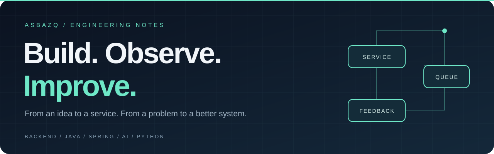

  

  <strong>만들고, 관찰하고, 더 나은 구조로 개선합니다.</strong> 
  Java · Spring 기반으로 서비스를 만들고, 사용 중 만난 문제를 코드와 설계로 풀어갑니다.

  
  
  

 

## 01 / Selected work

### [YuGiOhDeck ↗](https://github.com/asbazq/YuGiOhDeck)
**카드 검색부터 덱 구성·공유, AI 카드 판별까지.**

유희왕 덱 구성 및 공유 플랫폼입니다. MySQL Full-Text 검색, URL 기반 덱 공유, Redis 대기열을 적용하고 API와 크롤러의 실행 역할을 분리했습니다.

`Spring Boot` `React` `MySQL` `Redis` `FastAPI`

---

### [QueueSystem ↗](https://github.com/asbazq/queueSystem)
**몰리는 요청은 순서 있게, 입장은 안전하게.**

Redis Sorted Set과 Lua Script로 입장·승급을 원자적으로 처리합니다. WebSocket으로 대기 상태를 전달하고, Heartbeat와 TTL로 이용 상태를 관리합니다.

`Java` `Spring Boot` `Redis` `Lua` `WebSocket`

---

### [RoutineHub ↗](https://github.com/asbazq/myproteinPrice)
**가격 기록을 모아, 구매 판단에 도움이 되는 화면으로.**

마이프로틴 가격을 수집·저장하고, ARIMA/ARX 기반 예측 결과를 React 대시보드로 보여주는 서비스입니다.

`Spring Boot` `Selenium` `MySQL` `React` `Recharts`

 

## 02 / Engineering focus

| 관심사 | 프로젝트에서 다룬 내용 |
| :--- | :--- |
| **트래픽과 동시성** | Redis 대기열 · Lua 원자 연산 · 입장 인원 제어 |
| **서비스와 데이터** | Spring API · MySQL 검색 · 수집 프로세스 분리 |
| **실시간 사용자 경험** | WebSocket 상태 전달 · 재연결과 세션 수명 관리 |
| **관찰과 개선** | 부하 테스트 · 응답 흐름 분석 · 기술 선택과 트러블슈팅 기록 |

 

## 03 / Toolbox

**Backend** &nbsp; Java · Spring Boot · Spring Data JPA  
**Data & Messaging** &nbsp; MySQL · Redis · WebSocket  
**Frontend** &nbsp; React · JavaScript  
**Infra & Collection** &nbsp; Docker Compose · AWS EC2 / RDS · Selenium · Jsoup

 

---

  작동하는 기능에서, 설명할 수 있는 설계로.

